## What's this?
以前からObsidianもWindsurfも使っていたので、Obsidian in CursorならぬObsidian in Windsurfには興味があったのですが、環境構築が何となく面倒くさそうだなと思い、後回しにしていました。

しかし、最近はあらゆるドキュメントをWindsurf起点で書くようになってきて、iPhoneにも同期したいし、Obsidianともいい感じに連携したいなと思い始めたので、重い腰を上げてやってみました。

というわけで、作業メモを残しておきます。

### 環境
- macOS: Sequoia 15.5
- Windsurf: 1.10.1
- iOS: 18.5
- Obsidian: 1.8.10（Mac / iPhone）

## インストール
まずは、ObsidianとWindsurfがないと始まらないのでインストールします。
ダウンロードページから、または`brew`経由でインストールしてください。

### Obsidian
- https://obsidian.md/download

```sh
$ brew install --cask obsidian
```

### Windsurf
- https://windsurf.com/download

```sh
$ brew install --cask windsurf
```

## Obsidianのセットアップ
Obsidianを起動し、新しいlocalのvaultを作成します。
今回はGit管理するので、GitHubリポジトリを管理しているディレクトリ配下で`windian`という名前のvaultを作成します。

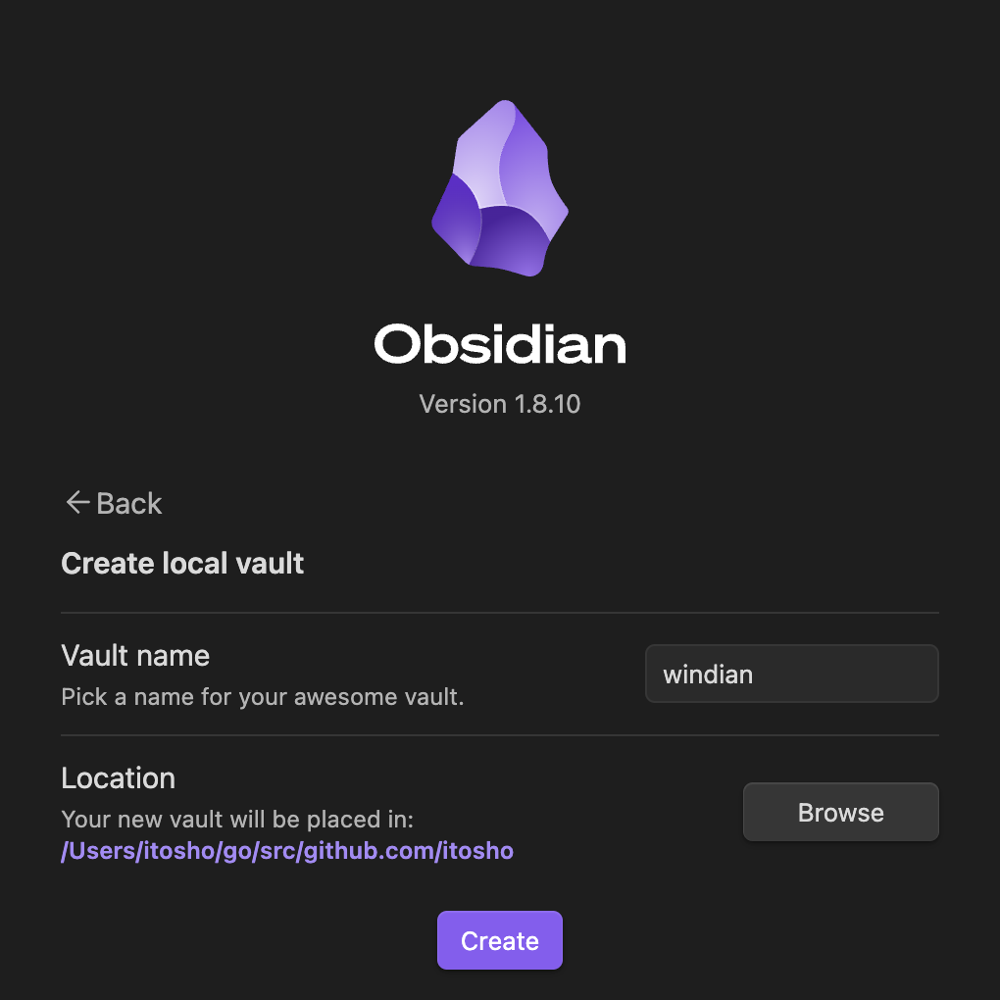

vaultが作成されると`Welcome.md`というファイルが作成されています。

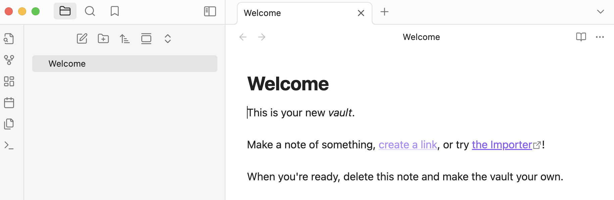

## Windsurfのセットアップ
Windsurfを起動し、Workspaceの設定で上記の`windian`ディレクトリを指定します。
先ほど作成された`Welcome.md`が存在していることを確認します。

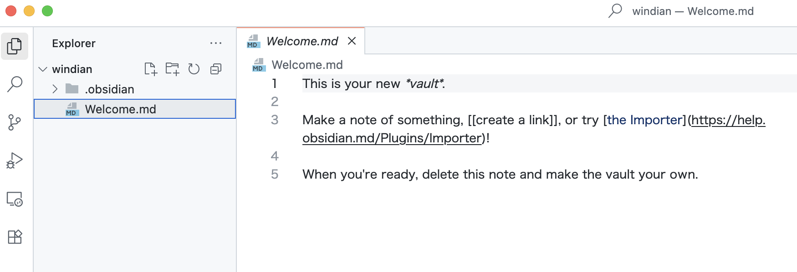

## Git環境のセットアップ

### GitHubリポジトリの作成
GitHub上に`windian`というリポジトリを作成しておきます。
次にローカルの`windian`ディレクトリで以下のコマンドを実行します。

```sh
$ git init
$ git add .
$ git commit -m "Setup Obsidian in Windsurf"
$ git remote add origin git@github.com:itosho/windian.git
$ git push -u origin main
```

GitHubリポジトリ側にローカルの内容がPushされていることを確認します。

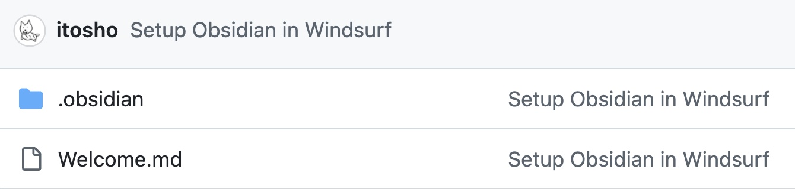

## obsidian-gitの設定
Obsidianのコミュニティプラグインから`obsidian-git`をインストールします。

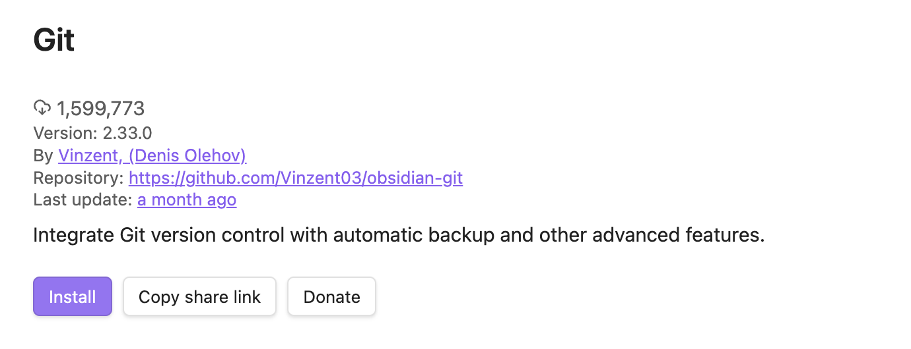

次にGitHub上でPersonal access token（Fine-grained tokens）を作成します。
対象リポジトリを先ほど作成した`windian`リポジトリのみにして、Read and write権限をContentsに付与します。


発行されたTokenを手元でコピーします。

## iPhone側のObsidianの設定

### obsidian-gitの設定
App StoreからObsidianアプリをインストールします。

https://apps.apple.com/jp/app/obsidian-connected-notes/id1557175442

PCと同様に`windian`という名前でvaultを作成します。
今回はGitで同期を行うため、Syncの設定はスキップして問題ありません。

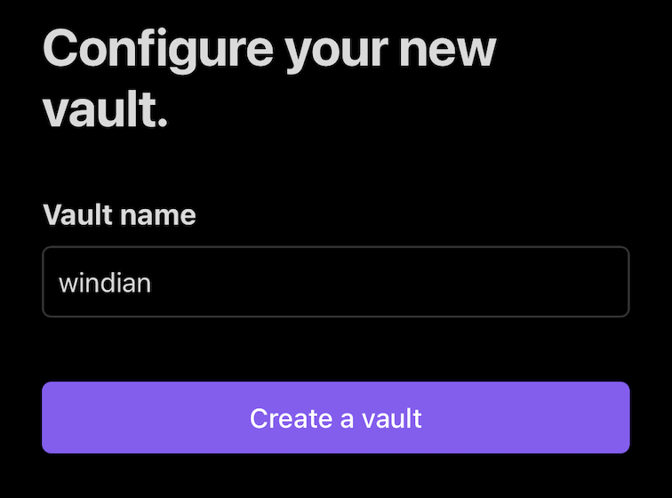

設定画面のコミュニティプラグインから`obsidian-git`をインストールします。
プラグインを有効化した後はOptionsから設定を行うことが出来ます。

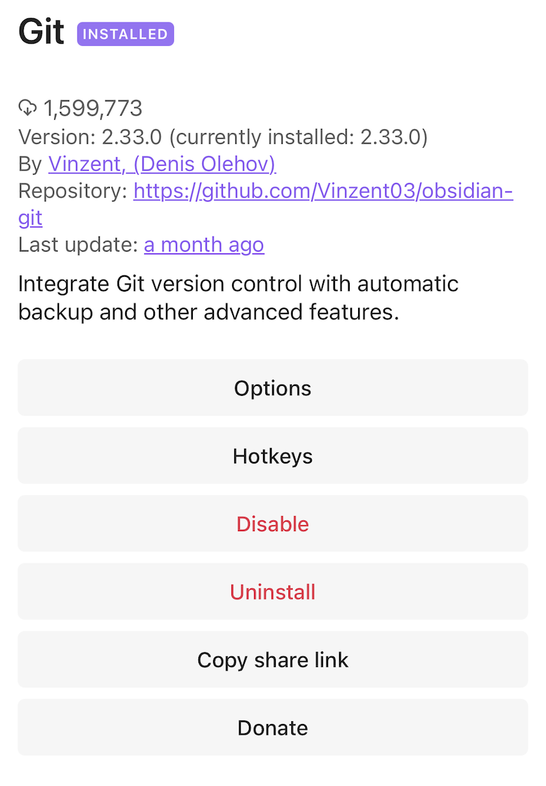

GitHubのユーザー名と先ほど作成したPersonal Access Tokenの設定を行います。
また、Authorの設定も行います。

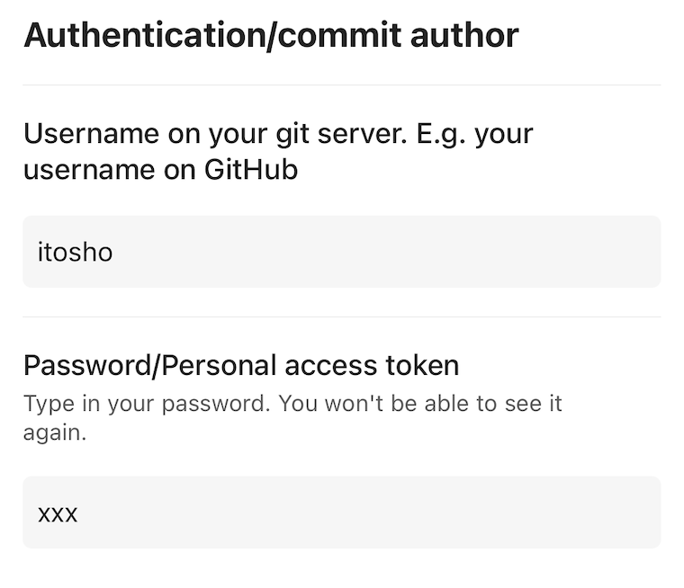

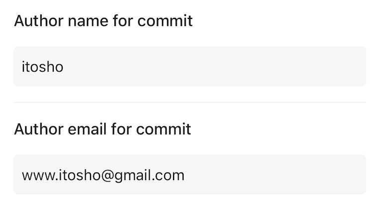

### 同期の確認
メニュー画面の`Open command palette`から`git clone`コマンドを実行します。
Remote URLはGitHubリポジトリのHTTPSのURLを入力します。
その後、いくつか設定内容を訊かれますが、新規の場合はデフォルトの選択肢を選べばOKだと思います。

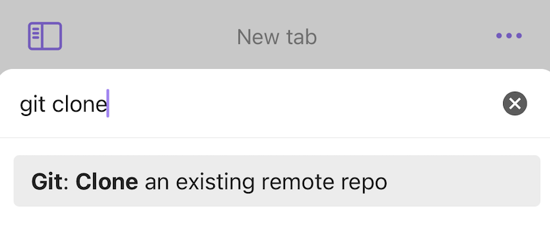

`Welcome.md`が同期されていればOKです。

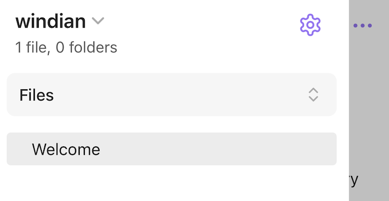

次にファイルを適当に更新します。

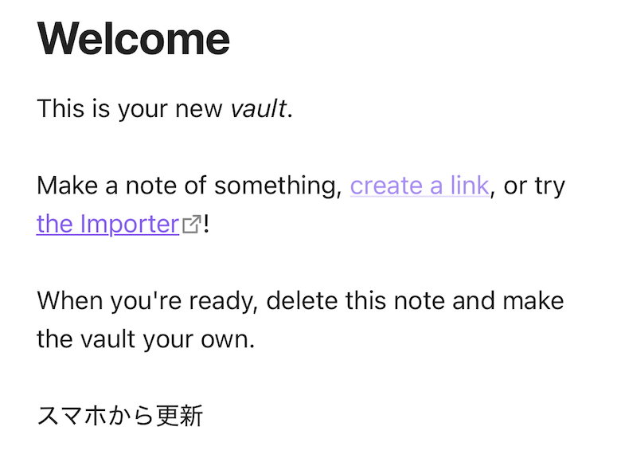

メニュー画面から`Open Git source control`を開きます。

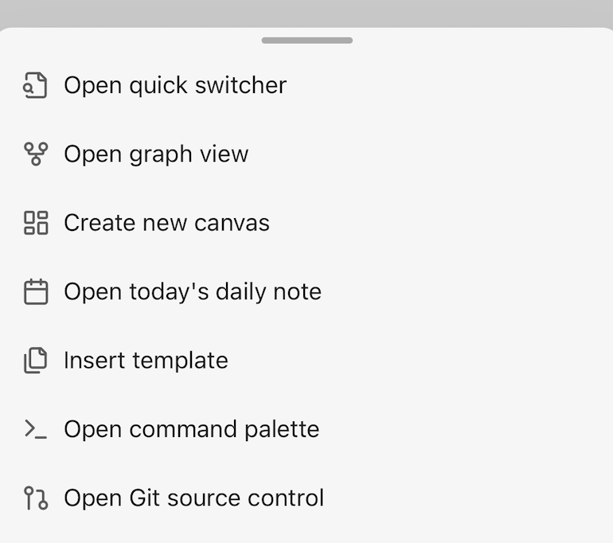

+ボタンで全ての変更を`stage`し、✓ボタンで`commit`し、↑ボタンで`push`します。

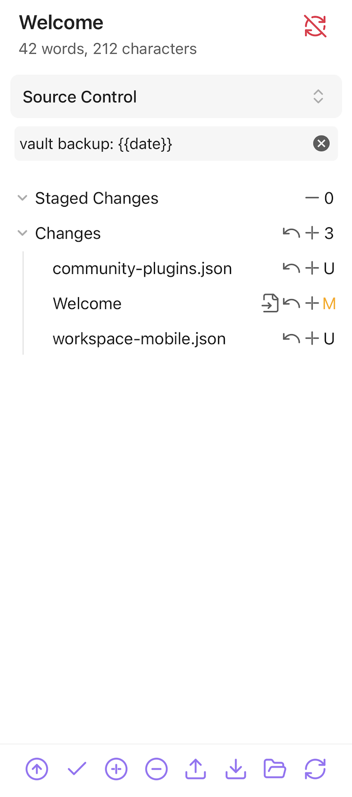

GitHub側に変更内容が`Push`されていれば、問題ありません。
PC側でも`Pull`して、Windsurf（Obsidian）に変更内容が反映されていれば、環境構築は完了です！

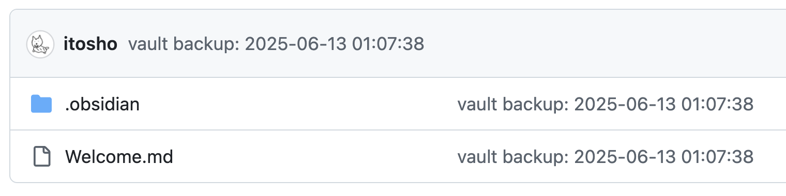

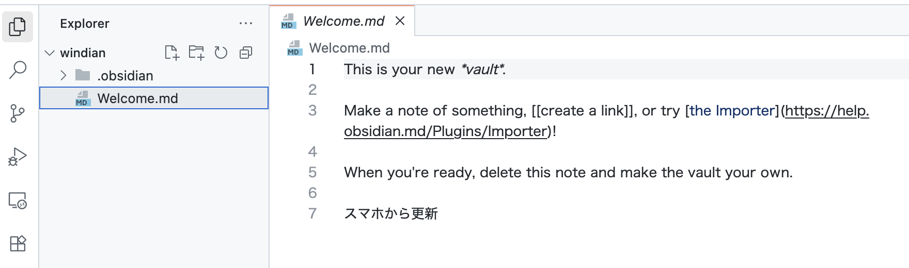

## 参考URL
- https://note.com/shotovim/n/na1d91f10c1d0
- https://zenn.dev/ishikawa096/articles/158246fc5a5d62
- https://note.com/yriica/n/n4bb208f877d1
- https://note.com/sho7650/n/n9f8657c7aa81
